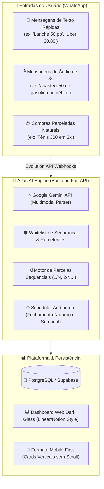
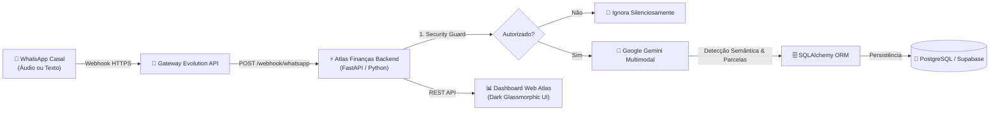

# 🤖 Atlas Finanças - Inteligência Artificial & Gestão Orçamentária Doméstica

> **Resumo Executivo:** Plataforma de inteligência financeira e planejamento orçamentário doméstico construída em **Python (FastAPI)** e **PostgreSQL (Supabase)**, impulsionada pelo agente autônomo **Atlas** via **Google Gemini API** e **WhatsApp (Evolution API)**. Conta com processamento de mensagens de texto e voz (multimodal), categorização financeira por NLP, projeção sequencial de parcelas, automações noturnas/semanais e painel analítico responsivo (Dark Glassmorphic UI).

[](https://fintrack-intelligence.onrender.com)
[](https://fastapi.tiangolo.com)
[](https://www.python.org)
[](https://supabase.com)
[](https://ai.google.dev/)
[](https://github.com/GodoyDevv/financas)

---

## 🌟 Conheça o Atlas: Nosso Assistente de IA Autônomo

O **Atlas Finanças** não é um simples chatbot com regras rígidas. Ele é um **Agente Inteligente Multimodal** projetado para eliminar o atrito no controle financeiro de casais e famílias:



---

## 📌 O Problema Real Resolvido

1. **Atrito Zero de Imputação:** O controle financeiro tradicional fracassa porque o usuário precisa abrir planilhas ou apps bancários logo após a compra. Com o Atlas, a despesa é lançada em linguagem natural ou áudio no WhatsApp em menos de 3 segundos.
2. **Resiliência a Typos e Vida Real:** Se o usuário digitar rápido `Lanche 50,pp`, o Atlas usa o raciocínio semântico do Gemini para entender o contexto, extrair R$ 50,00 e classificar como *Alimentação* em vez de travar com mensagens de erro.
3. **Ilusão do Fluxo de Caixa por Parcelamentos:** Ao passar uma compra de R$ 600 em 3x, registrar R$ 600 no mês atual destrói os indicadores daquele mês e oculta a dívida futura. O Atlas gera as fatias `(1/3)`, `(2/3)` e `(3/3)` com datas mensais sequenciais e permite exclusão em lote.
4. **Previsibilidade Orçamentária:** Rendas e despesas fixas recorrentes são preservadas mês a mês, permitindo saber com precisão o **Saldo Livre Real** em qualquer período futuro.

---

## 🚀 Recursos do Sistema

| Dimensão | Como o Atlas Finanças Opera | Impacto no Dia a Dia |
| :--- | :--- | :--- |
| **Ingestão por Voz & Texto** | Áudios e textos processados pela API do Google Gemini | Lançar gastos dirigindo, cozinhando ou com pressa sem tocar no teclado. |
| **Identificação de Emissor** | Vincula automaticamente se a despesa foi feita pelo Bruno ou pela Letícia | Gamificação saudável e transparência de quem gastou mais no mês. |
| **Filtros Facetados (Notion/Linear)** | Busca por categoria, data e descrição com contagem e somas acumuladas instantâneas | Respostas imediatas como: *"Quanto gastamos de gasolina até agora?"*. |
| **Layout Mobile-First** | Tabela desktop adaptada no celular para cards verticais em formato de lista | Usabilidade com uma só mão sem barras de rolagem horizontais desconfortáveis. |
| **Rotina Autônoma de Relatórios** | Notificações diárias noturnas (21h30-22h) e fechamento semanal macro (sábados 22h) | Fechamento automático no WhatsApp com principais ofensores e divisão percentual. |

---

## 🛠️ Tecnologias & Arquitetura



- **Linguagem & Backend:** Python 3.10+ | FastAPI | Uvicorn
- **Inteligência Artificial:** Google Gemini API (NLP estruturado & Multimodal Áudio/Texto)
- **Persistência de Dados:** SQLAlchemy ORM | PostgreSQL (Supabase) com fallback para SQLite local
- **Mensageria & Webhooks:** Evolution API (WhatsApp)
- **Frontend & Visualização:** Vanilla JS moderno, CSS Glassmorphism responsivo, Chart.js
- **Automação & Schedulers:** Tarefas assíncronas em background (Python `asyncio`)
- **Infraestrutura:** Render Cloud

---

## 🔒 Segurança, Governança & LGPD

- **Whitelist Restrita de Mensageria:** O webhook rejeita qualquer mensagem que não venha do grupo oficial autorizado (`WHATSAPP_GROUP_JID`) ou que parta de números não cadastrados na lista de remetentes (`ALLOWED_PHONE_NUMBERS`).
- **Segurança de Credenciais:** Nenhuma credencial de banco, token de webhook ou chave de API reside no código-fonte. Tudo é injetado via variáveis de ambiente seguras (`.env`).
- **Prevenção de Vazamento no Git:** Configuração avançada de `.gitignore` cobrindo segredos, caches, bancos locais (`*.sqlite`, `*.db`) e artefatos de build.

---

## ⚙️ Como Executar Localmente

### 1. Clonar o repositório
```bash
git clone https://github.com/GodoyDevv/financas.git
cd financas
```

### 2. Criar e ativar o ambiente virtual
```bash
# Windows
python -m venv .venv
.venv\Scripts\activate

# Linux / MacOS
python3 -m venv .venv
source .venv/bin/activate
```

### 3. Instalar as dependências
```bash
pip install -r requirements.txt
```

### 4. Configurar variáveis de ambiente
Copie o modelo:
```bash
cp .env.example .env
```
*(Se nenhuma variável for fornecida, o sistema inicia em modo SQLite local autônomo).*

### 5. Iniciar o servidor
```bash
uvicorn backend.main:app --reload
```

- **Dashboard:** `http://127.0.0.1:8000`
- **Swagger OpenAPI:** `http://127.0.0.1:8000/docs`

---

## 👨‍💻 Autor & Manutenção
Projeto desenvolvido e mantido por **Bruno Godoy**, demonstrando excelência em Engenharia de Software, Arquitetura de Microsserviços com FastAPI, Agentes Autônomos com Google Gemini, Integração de Mensageria em Tempo Real e Foco Contínuo em Experiência do Usuário (UX/UI).
