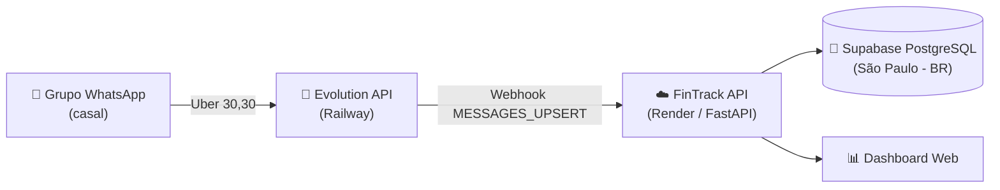

# 💸 FinTrack Intelligence

<p align="center">
  
  
  
  
  
  
</p>

<p align="center">
  <b>Controle financeiro do casal com dashboard em tempo real e lançamento de gastos direto pelo WhatsApp.</b>
</p>

---

## 📌 Visão Geral

O **FinTrack Intelligence** centraliza as finanças da casa em um único painel. Os gastos do dia a dia são lançados
por **mensagem de WhatsApp** (ex.: `Uber 30,30`) em um grupo compartilhado: o sistema interpreta o texto, identifica
**quem gastou**, categoriza automaticamente e atualiza o dashboard na hora com persistência garantida no **Supabase (São Paulo/BR)**.

---

## 🚀 Funcionalidades

- **📲 Lançamento por WhatsApp**: mensagens em linguagem natural viram transações (valor, categoria e responsável).
- **👫 Multiusuário**: identifica o autor da mensagem (individual ou em grupo) pelo telefone/perfil (Bruno ou Letícia).
- **🧾 Extrato em ordem de lançamento**: o registro mais recente aparece sempre no topo, como um extrato bancário.
- **📊 Dashboard interativo**: cards de receitas, contas fixas, gastos variáveis e saldo livre, além de gráficos por categoria.
- **✍️ CRUD completo** de transações pela interface web (criar, editar, excluir, filtrar por tipo).
- **🩺 Healthcheck** em `/health` e documentação OpenAPI em `/docs`.
- **☁️ Deploy automático**: cada `push` na `main` publica uma nova versão no Render integrada ao banco em produção.

---

## 🏗️ Arquitetura



| Componente | Função | Hospedagem |
| :--- | :--- | :--- |
| **FinTrack API + Dashboard** | Regras de negócio, parser, API REST e interface web | Render (Web Service) |
| **Evolution API** | Gateway que conecta o WhatsApp e dispara webhooks | Railway (com Postgres e Redis) |
| **Banco de dados** | Armazena e persiste todas as transações permanentemente | Supabase PostgreSQL (São Paulo - BR) |

---

## 💬 Como lançar gastos pelo WhatsApp

Envie no grupo uma mensagem com a **descrição e o valor**:

| Mensagem | Valor | Categoria |
| :--- | :--- | :--- |
| `Uber 30,30` | R$ 30,30 | Transporte |
| `Almoço 76,00` | R$ 76,00 | Alimentação |
| `Farmácia 38` | R$ 38,00 | Saúde |
| `Cinema 45,90` | R$ 45,90 | Lazer |

Categorias reconhecidas: Alimentação, Transporte, Moradia, Lazer, Saúde, Salário/Renda e Outros
(regras em [`backend/parser.py`](backend/parser.py)).

---

## 🔌 Endpoints principais

| Método | Rota | Descrição |
| :--- | :--- | :--- |
| `GET` | `/` | Dashboard web |
| `GET` | `/health` | Status da aplicação |
| `GET` | `/api/transactions` | Lista transações (mais recentes primeiro). Filtro: `?tipo=` |
| `POST` | `/api/transactions` | Cria transação |
| `PUT` / `DELETE` | `/api/transactions/{id}` | Edita / remove transação |
| `GET` | `/api/summary` | Totais de receitas, despesas e saldo livre |
| `GET` | `/api/metrics` | Métricas e distribuição por categoria |
| `POST` | `/api/parse-message` | Interpreta uma mensagem em texto livre |
| `POST` | `/webhook/whatsapp` | Receptor de webhooks da Evolution API |

---

## 📂 Estrutura do Projeto

```plaintext
financas/
├── backend/
│   ├── main.py             # App FastAPI, CORS e montagem das rotas
│   ├── routes.py           # API REST (CRUD, resumo e métricas) + inicialização do banco
│   ├── webhook.py          # Receptor de webhooks do WhatsApp e identificação do autor
│   ├── parser.py           # Interpretação de mensagens e categorização
│   ├── schemas.py          # Schemas Pydantic
│   ├── models.py           # Modelos de dados
│   ├── database.py         # Configuração do banco
│   └── initial_data.json   # Carga inicial usada quando o banco está vazio
├── index.html              # Dashboard web
├── render.yaml             # Blueprint de deploy (Render)
├── requirements.txt        # Dependências Python
└── builder.py              # Utilitário de geração assistida (requer GEMINI_API_KEY)
```

---

## ⚙️ Execução Local

```bash
git clone https://github.com/GodoyDevv/financas.git
cd financas

python -m venv venv
.\venv\Scripts\activate          # Windows  (Linux/macOS: source venv/bin/activate)

pip install -r requirements.txt
uvicorn backend.main:app --reload --port 8000
```

Painel em `http://localhost:8000` · Swagger em `http://localhost:8000/docs`.

---

## ☁️ Deploy

O deploy é feito no **Render** a partir do [`render.yaml`](render.yaml):

- **Build**: `pip install -r requirements.txt`
- **Start**: `uvicorn backend.main:app --host 0.0.0.0 --port $PORT`
- **Auto-deploy**: a cada commit na branch `main`.

### Integração com o WhatsApp (Evolution API)

1. Suba a Evolution API (ex.: template do Railway com Postgres + Redis).
2. Crie uma instância `WHATSAPP-BAILEYS` e conecte o número lendo o QR Code.
3. Configure o webhook da instância:
   - **URL**: `https://<seu-app>.onrender.com/webhook/whatsapp`
   - **Evento**: `MESSAGES_UPSERT`
4. Configure as variáveis de ambiente baseadas no [`.env.example`](.env.example):
   - `DATABASE_URL`: URI de conexão PostgreSQL (Supabase ou outro provedor).
   - `WHATSAPP_USER_BRUNO`: Telefone do primeiro usuário (DDI + DDD + número).
   - `WHATSAPP_USER_LETICIA`: Telefone do segundo usuário (DDI + DDD + número).

> 🔒 **Boas Práticas de Segurança:** Nenhuma credencial ou número pessoal fica salvo no código. Todas as configurações sensíveis utilizam variáveis de ambiente (`.env`).

---

---

## 🔒 Segurança e Privacidade

- **Repositório Privado**: O repositório está configurado como privado no GitHub para total segurança dos seus dados e infraestrutura.
- **Variáveis de Ambiente**: As credenciais (`DATABASE_URL`, API Keys) são injetadas estritamente via variáveis de ambiente no Render, sem exposição no código-fonte.

---

## ⚠️ Observações de Operação

- **Cold start**: no plano gratuito do Render, caso o serviço fique inativo por muito tempo, a primeira requisição pode levar ~30s para iniciar a instância (o banco de dados permanece 100% intacto no Supabase).
- **Classificação WhatsApp**: mensagens recebidas pelo grupo são tratadas como `despesa_variavel` (receitas e despesas fixas recorrentes podem ser gerenciadas pelo painel web).

---

## 🤝 Autor

Desenvolvido por **[Godoy](https://github.com/GodoyDevv)**.
