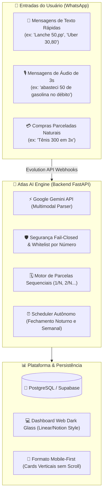
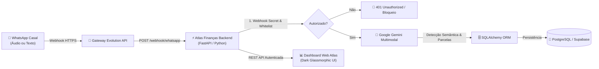

# 🤖 Atlas Finanças - Inteligência Artificial & Gestão Orçamentária Doméstica

> **Resumo Executivo:** Plataforma de inteligência financeira e planejamento orçamentário doméstico construída em **Python (FastAPI)** e **PostgreSQL (Supabase)**, impulsionada pelo agente autônomo **Atlas** via **Google Gemini API** e **WhatsApp (Evolution API)**. Conta com processamento de mensagens de texto e voz (multimodal), categorização financeira por NLP, projeção sequencial de parcelas, automações noturnas/semanais e painel analítico responsivo (Dark Glassmorphic UI).

[](https://fastapi.tiangolo.com)
[](https://www.python.org)
[](https://supabase.com)
[](https://ai.google.dev/)

---

## 🌟 Conheça o Atlas: Nosso Assistente de IA Autônomo

O **Atlas Finanças** não é um simples chatbot com regras rígidas. Ele é um **Agente Inteligente Multimodal** projetado para eliminar o atrito no controle financeiro de casais e famílias:



---

## 📌 O Problema Real Resolvido

1. **Atrito Zero de Imputação:** O controle financeiro tradicional fracassa porque o usuário precisa abrir planilhas ou apps bancários logo após a compra. Com o Atlas, a despesa é lançada em linguagem natural ou áudio no WhatsApp em menos de 3 segundos.
2. **Resiliência a Typos e Vida Real:** Se o usuário digitar rápido `Lanche 50,pp`, o Atlas usa o raciocínio semântico do Gemini para entender o contexto, extrair R$ 50,00 e classificar como *Alimentação* em vez de travar com mensagens de erro.
3. **Ilusão do Fluxo de Caixa por Parcelamentos:** Ao passar uma compra de R$ 600 em 3x, registrar R$ 600 no mês atual destrói os indicadores daquele mês e oculta a dívida futura. O Atlas gera as fatias `(1/3)`, `(2/3)` e `(3/3)` com datas mensais sequenciais e permite exclusão em lote.
4. **Previsibilidade Orçamentária:** Rendas e despesas fixas recorrentes são preservadas mês a mês, permitindo saber com precisão o **Saldo Livre Real** em qualquer período futuro.

---

## 🚀 Recursos do Sistema

| Dimensão | Como o Atlas Finanças Opera | Impacto no Dia a Dia |
| :--- | :--- | :--- |
| **Ingestão por Voz & Texto** | Áudios e textos processados pela API do Google Gemini | Lançar gastos dirigindo, cozinhando ou com pressa sem tocar no teclado. |
| **Identificação de Emissor** | Vincula automaticamente se a despesa foi feita pelo Bruno ou pela Letícia | Gamificação saudável e transparência de quem gastou mais no mês. |
| **Filtros Facetados (Notion/Linear)** | Busca por categoria, data e descrição com contagem e somas acumuladas instantâneas | Respostas imediatas como: *"Quanto gastamos de gasolina até agora?"*. |
| **Layout Mobile-First** | Tabela desktop adaptada no celular para cards verticais em formato de lista | Usabilidade com uma só mão sem barras de rolagem horizontais desconfortáveis. |
| **Rotina Autônoma de Relatórios** | Notificações diárias noturnas (21h30-22h) e fechamento semanal macro (sábados 22h) | Fechamento automático no WhatsApp com principais ofensores e divisão percentual. |

---

## 🛠️ Tecnologias & Arquitetura



- **Linguagem & Backend:** Python 3.10+ | FastAPI | Uvicorn
- **Inteligência Artificial:** Google Gemini API (NLP estruturado & Multimodal Áudio/Texto com envio seguro por cabeçalho)
- **Persistência de Dados:** SQLAlchemy ORM | PostgreSQL (Supabase) com fallback para SQLite local
- **Mensageria & Webhooks:** Evolution API (WhatsApp)
- **Frontend & Visualização:** Vanilla JS com escape obrigatório contra XSS, CSS Glassmorphism responsivo, Chart.js com SRI (Subresource Integrity)
- **Automação & Schedulers:** Tarefas assíncronas em background (Python `asyncio`)
- **Infraestrutura:** Render Cloud

---

## 🔒 Arquitetura de Segurança, Governança & LGPD

O Atlas Finanças foi desenvolvido adotando os princípios de **Segurança por Padrão (*Secure by Default*)** e **Falha Fechada (*Fail-Closed*)**:

### 1. Autenticação e Sessão (Dashboard & API)
- **Falha Fechada na Inicialização:** O backend recusa-se a iniciar se faltarem as variáveis obrigatórias `APP_PASSWORD`, `SESSION_SECRET` (mínimo 32 caracteres) ou `ADMIN_TOKEN`.
- **Cookies de Sessão Criptografados:** Utiliza `itsdangerous` com as flags `HttpOnly`, `SameSite=Strict`, expiração automática e flag `Secure` obrigatória em produção (desativada apenas via `DEV_INSECURE_COOKIES=1` em localhost).
- **Proteção Anti-Timing:** Todas as comparações de senhas e tokens administrativos utilizam `hmac.compare_digest`.
- **Rate Limiting no Login:** Máximo de 5 tentativas por minuto por IP com resposta `429 Too Many Requests`.
- **Proteção CSRF:** Verificação obrigatória do cabeçalho `Origin` em requisições de mutação (`POST`, `PUT`, `DELETE`).
- **Endpoints Administrativos:** Rotas de disparo de relatórios exigem o cabeçalho `X-Admin-Token`.

### 2. Pipeline Híbrido de NLP & Privacidade com LLM (Google Gemini)
- **Privacidade por Desenho (Privacy-First):** Mensagens comuns do grupo do WhatsApp (conversas cotidianas, saudações como "bom dia", piadas ou mensagens sem nenhum valor monetário) **JAMAIS saem do servidor** e nunca são transmitidas para APIs de terceiros.
- **Parser Determinístico Primeiro:** O processamento inicial é realizado 100% localmente por regex otimizado com fronteiras de palavras (`\b`), isolando valores monetários e parcelamentos antes de classificar categorias.
- **Fallback Inteligente:** O Google Gemini (`GEMINI_MODEL=gemini-2.5-flash`) com saída estruturada JSON (`responseSchema`) só é acionado quando a confiança da análise local for baixa (ambiguidade ou categoria desconhecida).
- **Anti-Alucinação & Anti-Injeção:** O valor extraído pelo Gemini passa por conferência cruzada obrigatória com os números identificados no texto original. Instruções do usuário são tratadas estritamente como dados brutos em campo separado, evitando sobreposição de instruções.
- **Fail-Safe & Timeout Curto:** Timeout estrito (<= 8s) com no máximo 1 tentativa. Em caso de falha de conexão ou resposta inválida, o sistema recorre de forma segura à classificação local ou solicita esclarecimento ao usuário.

### 3. Blindagem do Webhook do WhatsApp
- **Autenticação por Segredo:** Verificação do cabeçalho `X-Webhook-Secret` via `hmac.compare_digest` antes de qualquer processamento ou chamada de IA.
- **Suporte Alternativo a Token na URL:** Rota opcional `/webhook/whatsapp/{token}` configurável via `WEBHOOK_ALLOW_PATH_TOKEN=1` para versões legadas da Evolution API.
- **Autorização Estrita por Telefone:** O remetente é autorizado exclusivamente por igualdade exata de número normalizado (com ou sem DDI 55). O campo volátil `pushName` foi completamente eliminado da lógica de autorização.
- **Limites de Entrada Rígidos (Anti-DoS):** Rejeição de requisições com corpo > 1 MB, truncamento de mensagens em 500 caracteres e rejeição de áudios acima de 2 MB antes da descriptografia ou envio para a API de IA.
- **Deduplicação Pós-Autorização:** O registro de IDs de mensagens ocorre estritamente após a autenticação bem-sucedida.

### 4. Defesa Contra Injeção e XSS (Cross-Site Scripting)
- **Frontend Seguro:** Todos os campos de texto vindos do banco (`descricao`, `categoria`, `source`, `vencimento`) passam por escape rigoroso via utilitário `escapeHtml()` antes da renderização no DOM. Eventos inline com interpolação de dados foram substituídos por atributos `data-*` e listeners delegados (`addEventListener`).
- **Defesa em Profundidade no Backend:** Schemas Pydantic tipados com `Literal["receita", "despesa_fixa", "despesa_variavel"]`, limites de caracteres (`descricao` 200, `categoria` 60, `source` 40), validação de valores entre R$ 0,01 e R$ 1.000.000,00 e sanitização de caracteres de controle ASCII C0/C1.
- **Subresource Integrity (SRI):** A biblioteca externa Chart.js (v4.4.7) possui verificação de integridade criptográfica `integrity="sha384-..."` e `crossorigin="anonymous"`.

### 4. Cabeçalhos HTTP de Segurança & Hardening de Infraestrutura
- **Security Headers Ativos:** `X-Content-Type-Options: nosniff`, `X-Frame-Options: DENY`, `Referrer-Policy: strict-origin-when-cross-origin`, `Permissions-Policy` restritiva e `HSTS` ativado em conexões HTTPS/produção.
- **Cache-Control Restritivo:** Cabeçalho `no-store, no-cache, must-revalidate` aplicado a todas as respostas do dashboard (`/`) e da API (`/api`).
- **Content-Security-Policy (CSP):** Atualmente em modo `Content-Security-Policy-Report-Only` para monitoramento. *(TODO: migrar para nonce/hash em scripts inline na próxima fase)*.
- **CORS Restritivo:** Sem permissão ampla (`*`) com credenciais. Acesso restrito a origens explicitamente cadastradas na variável `ALLOWED_ORIGINS`.
- **Sanitização do Endpoint /health:** O endpoint `/health` responde unicamente `{"status":"online"}`, sem expor o tipo de banco de dados ou detalhes internos.
- **Swagger / OpenAPI Ocultados em Produção:** As rotas `/docs`, `/redoc` e `/openapi.json` são automaticamente desativadas quando `ENV=production`.

### 5. Prevenção e Monitoramento de Vazamento de Segredos
- **Suíte de Testes Automatizada:** 38 testes cobrindo autenticação, webhook, sanitização de entrada, CSP, headers, schemas e migrações Alembic.
- **Pre-commit & Gitleaks:** Regras locais configuradas em `.pre-commit-config.yaml` e `.gitleaks.toml`.
- **Dependabot:** Monitoramento semanal automatizado de dependências pip e GitHub Actions via `.github/dependabot.yml`.

### ⚠️ Limitações Conhecidas & Observações de Operação
- **Cold Start do Provedor de Nuvem:** No plano gratuito do Render, caso o serviço permaneça inativo, a primeira requisição pode levar ~30s para inicialização da instância (o banco de dados relacional permanece intacto e conectado no Supabase).
- **Rate Limit em Memória:** O limitador de tentativas de login é mantido na memória do worker. Para arquiteturas com múltiplos workers Uvicorn, recomenda-se transicionar para Redis.
- **Histórico do Git:** Dumps e arquivos de seed anteriores foram removidos do working tree e protegidos no `.gitignore`. O expurgo retroativo da árvore antiga do Git está documentado no runbook interno de segurança.

---

## 🗄️ Banco de Dados e Migrations (Alembic)

O projeto adota o **Alembic** para versionamento estrutural do banco de dados relacional (SQLite localmente e PostgreSQL/Supabase em produção). O código da aplicação não executa mais `create_all`, garantindo previsibilidade e rastreabilidade absoluta de schema.

### Comandos Essenciais

```bash
# 1. Verificar divergências entre os models SQLAlchemy e o banco atual (SOMENTE LEITURA)
python scripts/check_schema_drift.py

# 2. Criar uma nova migration automaticamente a partir de alterações nos models
alembic revision --autogenerate -m "descricao_da_mudanca"

# 3. Aplicar todas as migrations pendentes até a versão mais recente
alembic upgrade head

# 4. Reverter a última migration aplicada
alembic downgrade -1

# 5. Inspecionar a versão atual registrada no banco
alembic current
```

### 🔒 Fluxo Seguro de Deploy em Produção

Antes de qualquer deploy que envolva novas migrações estruturais:
1. **Executar backup obrigatório do banco de produção** (Snapshot no Supabase ou via `python scripts/backup_db.py`).
2. **Validar ausência de drift acidental** executando:
   ```bash
   DATABASE_URL="postgresql+psycopg2://..." python scripts/check_schema_drift.py
   ```
3. O deploy no Render executa automaticamente `alembic upgrade head` antes de subir o servidor FastAPI, garantindo que a aplicação só inicie após a migração ser concluída com sucesso.

---

## ⚙️ Como Executar Localmente

### 1. Clonar o repositório
```bash
git clone https://github.com/GodoyDevv/financas.git
cd financas
```

### 2. Criar e ativar o ambiente virtual
```bash
# Windows
python -m venv .venv
.venv\Scripts\activate

# Linux / MacOS
python3 -m venv .venv
source .venv/bin/activate
```

### 3. Instalar as dependências
```bash
pip install -r requirements.txt
```

### 4. Configurar variáveis de ambiente
Copie o modelo seguro de variáveis:
```bash
cp .env.example .env
```
Preencha `APP_PASSWORD`, `SESSION_SECRET`, `ADMIN_TOKEN`, `WEBHOOK_SECRET` e `WHATSAPP_GROUP_JID`.

### 5. Executar os Testes Automatizados
```bash
pytest tests/ -v
```

### 6. Iniciar o servidor
```bash
uvicorn backend.main:app --reload
```

- **Dashboard:** `http://127.0.0.1:8000` (redireciona para `/login`)
- **Swagger OpenAPI:** `http://127.0.0.1:8000/docs` (disponível em modo de desenvolvimento)

---

## 💻 Desenvolvimento & Portões de Qualidade

O projeto utiliza **uv** para gerenciamento moderno de dependências, garantindo ambientes herméticos e reprodutíveis em Windows, macOS e Linux.

### 1. Sincronizar o ambiente com uv
```bash
# Instala e sincroniza exatamente as versões travadas no uv.lock
uv sync --frozen
```

### 2. Executar testes e checagem de cobertura
```bash
# Executa a suíte completa de testes com checagem de cobertura (>= 71%)
uv run pytest
```

### 3. Linting e Formatação (Ruff)
```bash
# Verifica regras de linting
uv run ruff check .

# Corrige problemas automaticamente
uv run ruff check --fix .

# Verifica formatação de código
uv run ruff format --check .

# Aplica formatação automática
uv run ruff format .
```

### 4. Checagem Estática de Tipos (Mypy)
```bash
# Executa mypy com tipagem estrita nos módulos novos (auth, nlp, services)
uv run mypy
```

### 5. Instalar Hooks de Pre-commit
```bash
# Instala os hooks do git (gitleaks, ruff, checagens de arquivo)
uv run pre-commit install

# Executar os hooks manualmente em todos os arquivos
uv run pre-commit run --all-files
```

### 6. Atualizar `requirements.txt` a partir do lock
O deploy no Render utiliza `pip` a partir do `requirements.txt`. Para regenerá-lo a partir do `uv.lock`:
```bash
uv export --no-dev --no-hashes --output-file requirements.txt
```
> O teste automatizado `tests/test_requirements_sync.py` falha automaticamente se o `requirements.txt` estiver fora de sincronia com o `uv.lock`.

---

## 👨‍💻 Autor & Manutenção
Projeto desenvolvido e mantido por **Bruno Godoy**, demonstrando excelência em Engenharia de Software, Arquitetura de Microsserviços com FastAPI, Agentes Autônomos com Google Gemini, Integração de Mensageria em Tempo Real e Foco Contínuo em Experiência do Usuário (UX/UI).
