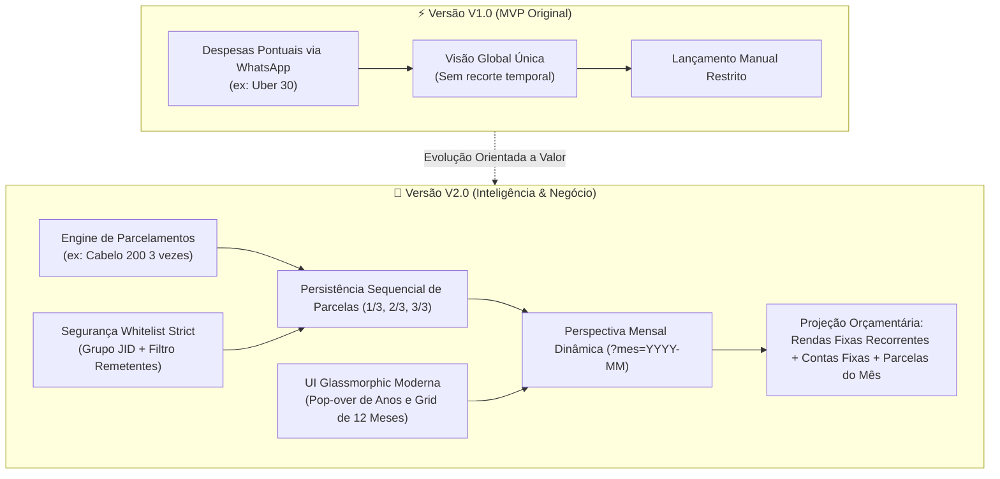
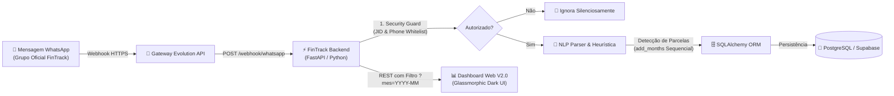

# 💸 FinTrack Intelligence V2.0 - Planejamento Doméstico & Inteligência Financeira

> **Resumo Executivo:** Plataforma de inteligência financeira e planejamento orçamentário construída em Python (FastAPI) e PostgreSQL (Supabase), com ingestão automatizada via Webhooks do WhatsApp, categorização via Processamento de Linguagem Natural (NLP heurístico), motor de despesas parceladas sequenciais e painel analítico com perspectiva mensal interativa (Dark Glassmorphic UI).

[](https://fintrack-intelligence.onrender.com)
[](https://fastapi.tiangolo.com)
[](https://www.python.org)
[](https://supabase.com)
[](https://github.com/GodoyDevv/financas)

---

## 🚀 Evolução Arquitetural: Da V1 à V2.0 (Visão de Produto & Negócio)

Para atender a cenários reais de orçamento familiar e corporativo, o FinTrack evoluiu de um simples captador de gastos pontuais para um **ecossistema de governança e projeção financeira mensal**:



### 📋 Comparativo de Recursos (V1 vs V2.0)

| Dimensão de Negócio | Versão V1 (MVP) | Versão V2.0 (Produção Atual) | Impacto no Negócio |
| :--- | :--- | :--- | :--- |
| **Ingestão WhatsApp** | Apenas compras à vista em formato básico | Suporte a parcelamentos naturais (`Cabelo 200 3 vezes`, `10x`, `em 4 parcelas`) | Registro de compras a prazo sem distorcer o fluxo de caixa de um único mês. |
| **Projeção Futura** | Não existia (tudo acumulado no total geral) | Navegação mensal com cálculo dinâmico de parcelas futuras | Visibilidade exata de quando cada compromisso financeiro termina (projeção em até 24x ou mais). |
| **Rendas & Contas Fixas** | Tratadas como transações comuns | Modelo recorrente preservado: entram automaticamente na base de todos os meses | Saldo livre real e previsível sem necessidade de redigitar salários todo mês. |
| **Governança & Segurança** | Webhook aberto para qualquer remetente | **Whitelist estrita**: mensagens restritas ao JID do grupo oficial e remetentes autorizados | Zero ruído de conversas privadas ou números desconhecidos; conformidade com LGPD. |
| **Interface do Usuário (UI)** | Barra tradicional estática | **Linear/Apple Dark Glass Popover**: seletor de ano rápido e grade dos 12 meses | Experiência fluida e ágil sem perder o estilo escuro elegante da aplicação. |

---

## 📌 O Problema de Negócio Resolvido

1. **Atrito de Imputação:** O controle financeiro tradicional fracassa porque o usuário precisa abrir planilhas ou apps bancários logo após a compra. Com o FinTrack, a despesa é lançada em linguagem natural no WhatsApp em menos de 5 segundos.
2. **Ilusão do Fluxo de Caixa por Compras Parceladas:** Ao passar uma compra de R$ 600 em 3x no cartão, registrar R$ 600 no mês atual destrói os indicadores daquele mês e oculta a dívida dos meses seguintes. O FinTrack V2.0 gera automaticamente as fatias `(1/3)`, `(2/3)` e `(3/3)` com datas de competência mensais sequenciais.
3. **Previsibilidade Orçamentária:** Ao navegar para novembro ou dezembro de 2026, as despesas fixas (aluguel, condomínio, internet) e receitas fixas já estão somadas junto às parcelas que cairão naquele período, apresentando o **Saldo Livre Real** projetado.

---

## 🛠️ Tecnologias & Arquitetura



- **Linguagem & Framework:** Python 3.10+ | FastAPI (ASGI / Uvicorn)
- **Persistência de Dados:** SQLAlchemy ORM | PostgreSQL (Supabase) com fallback para SQLite local
- **Contratos & Validação:** Pydantic v2
- **Integração & Mensageria:** Webhooks assíncronos via Evolution API / WhatsApp
- **Infraestrutura & Deploy:** Nuvem Render com deploy automatizado via Git

---

## 🔌 Principais Endpoints da API

| Método | Endpoint | Parâmetros | Finalidade Técnica & Negócio |
| :--- | :--- | :--- | :--- |
| `GET` | `/` | - | Interface web do Dashboard executivo V2.0 |
| `GET` | `/health` | - | Healthcheck de integridade do serviço e conexão de banco de dados |
| `GET` | `/api/transactions` | `?tipo=...&mes=YYYY-MM` | Extrato de transações filtrado por competência ou tipo |
| `POST` | `/api/transactions` | Body JSON | Cadastro manual com validação estrita (Pydantic) |
| `PUT` | `/api/transactions/{id}` | Body JSON | Edição e retificação de lançamentos |
| `DELETE` | `/api/transactions/{id}` | - | Estorno/remoção segura de lançamentos |
| `GET` | `/api/summary` | `?mes=YYYY-MM` | Consolidação do mês selecionado ou acumulado geral |
| `GET` | `/api/metrics` | `?mes=YYYY-MM` | KPIs do planejamento (Receitas, Fixas, WhatsApp e Saldo Livre) |
| `POST` | `/webhook/whatsapp` | Webhook Payload | Recepção e processamento de linguagem natural via WhatsApp |

---

## 📱 Exemplos de Lançamentos via WhatsApp (NLP)

O motor sintático do FinTrack compreende comandos financeiros em português natural:

```text
# Despesa à Vista
Almoço 45
Uber 32,50
Farmacia 89.90

# Despesas Parceladas (Gera parcelas mensais sequenciais automáticas)
Cabelo 200 3 vezes        -> Gera 3 parcelas de R$ 200 (mês atual, mês+1, mês+2)
Notebook 1500 em 10x      -> Gera 10 parcelas de R$ 1500
Geladeira 300 12 parcelas -> Gera 12 parcelas de R$ 300
```

---

## 🔒 Segurança, Governança & LGPD

- **Whitelist Restrita de Mensageria:** O webhook rejeita qualquer mensagem que não venha do grupo oficial autorizado (`WHATSAPP_GROUP_JID`) ou que parta de números não cadastrados na lista de remetentes (`ALLOWED_PHONE_NUMBERS`).
- **Segurança de Credenciais:** Nenhuma credencial de banco, token de webhook ou número telefônico reside no código-fonte. Tudo é injetado via variáveis de ambiente seguras (`.env`).
- **Prevenção de Vazamento no Git:** Configuração avançada de `.gitignore` cobrindo segredos, caches, bancos locais (`*.sqlite`, `*.db`) e artefatos de build.

---

## ⚙️ Como Executar Localmente

### 1. Clonar o repositório
```bash
git clone https://github.com/GodoyDevv/financas.git
cd financas
```

### 2. Criar e ativar o ambiente virtual
```bash
# Windows
python -m venv .venv
.venv\Scripts\activate

# Linux / MacOS
python3 -m venv .venv
source .venv/bin/activate
```

### 3. Instalar as dependências
```bash
pip install -r requirements.txt
```

### 4. Configurar variáveis de ambiente
Copie o modelo seguro:
```bash
cp .env.example .env
```
*(Se nenhuma variável for fornecida, o sistema inicia em modo SQLite local autônomo).*

### 5. Iniciar o servidor
```bash
uvicorn backend.main:app --reload
```

- **Dashboard:** `http://127.0.0.1:8000`
- **Swagger OpenAPI:** `http://127.0.0.1:8000/docs`

---

## 👨‍💻 Autor & Manutenção
Projeto desenvolvido e mantido por **Bruno Godoy**, demonstrando excelência em Engenharia de Software, Arquitetura de Microsserviços com FastAPI, Integração de Mensageria em Tempo Real e Foco Contínuo em Métricas de Valor para o Negócio.
