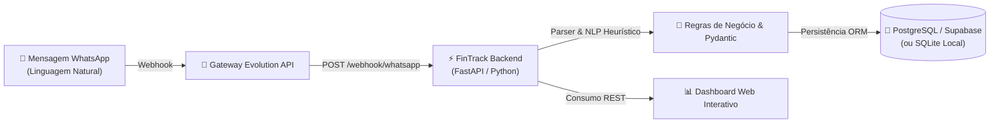

# 💸 FinTrack Intelligence - Automação & Gestão Financeira

> **Resumo Executivo:** Plataforma de gestão financeira e inteligência de lançamentos construída em Python (FastAPI) e PostgreSQL, com ingestão automatizada via Webhooks do WhatsApp, categorização via Processamento de Linguagem Natural (NLP heurístico) e painel em tempo real.

---

## 📌 Problema de Negócio Resolvido
- **Cenário Atual (Gargalo Operacional):** A maioria dos controles financeiros pessoais ou de pequenas operações falha pelo atrito de imputação: o usuário precisa abrir aplicativos bancários ou planilhas para cadastrar cada despesa, gerando atraso de lançamentos e esquecimentos frequentes.
- **Impacto no Negócio:** Falta de visibilidade de fluxo de caixa, divergências no saldo consolidado no final do mês e perda de rastreabilidade de despesas operacionais.
- **Solução Implementada:** Arquitetura orientada a eventos que permite lançamento instantâneo via WhatsApp em linguagem natural (ex: *"Uber 32,50"* ou *"Almoço 45"*). O backend intercepta o webhook, classifica a transação por regras de negócio e categoria, identifica o usuário remetente e persiste o dado de forma confiável no banco de dados relacional.

---

## 📊 Métricas de Valor & Benefícios
- ⏱️ **Redução de Atrito:** Lançamento de despesas em menos de **5 segundos** direto pelo mensageiro, eliminando a barreira manual de abertura de planilhas.
- 🎯 **Confiabilidade & Normalização:** Parser de texto que normaliza pontuações, trata moedas (vírgulas e pontos decimais) e aplica tipagem estrita com schemas Pydantic.
- 📈 **Visibilidade em Tempo Real:** Dashboard web com atualização instantânea de KPIs (Receitas, Contas Fixas, Gastos Variáveis e Saldo Livre), além de distribuição percentual por centro de custos.

---

## 🛠️ Tecnologias & Arquitetura



- **Linguagem & Framework:** Python 3.10+ | FastAPI (ASGI / Uvicorn)
- **Persistência de Dados:** SQLAlchemy ORM | PostgreSQL (Supabase) com fallback para SQLite local
- **Contratos & Validação:** Pydantic v2
- **Integração & Mensageria:** Webhooks assíncronos (compatível com Evolution API / WhatsApp)
- **Infraestrutura & Deploy:** Configuração de deploy contínuo em nuvem via `render.yaml`

---

## 🔌 Principais Endpoints da API

| Método | Endpoint | Finalidade Técnica & Negócio |
| :--- | :--- | :--- |
| `GET` | `/` | Interface web do Dashboard executivo |
| `GET` | `/health` | Healthcheck de integridade do serviço e conexão de banco de dados |
| `GET` | `/api/transactions` | Consulta paginada/ordenada de extrato com filtro por tipo (`receita`, `despesa_fixa`, `despesa_variavel`) |
| `POST` | `/api/transactions` | Cadastro manual de transações com validação estrita de dados |
| `PUT` / `DELETE` | `/api/transactions/{id}` | Manutenção, edição e estorno de lançamentos |
| `GET` | `/api/summary` | Consolidação agregada de totais de receitas, despesas e saldo líquido |
| `GET` | `/api/metrics` | Agrupamento analítico de despesas por categoria para tomada de decisão |
| `POST` | `/webhook/whatsapp` | Endpoint de recepção de eventos de mensageria para automação de entrada |

---

## ⚙️ Como Rodar o Projeto (Passo a Passo)

### 1. Clonar o repositório
```bash
git clone https://github.com/GodoyDevv/financas.git
cd financas
```

### 2. Criar e ativar o ambiente virtual
```bash
# Windows
python -m venv .venv
.venv\Scripts\activate

# Linux / MacOS
python3 -m venv .venv
source .venv/bin/activate
```

### 3. Instalar as dependências
```bash
pip install -r requirements.txt
```

### 4. Configurar variáveis de ambiente
Copie o arquivo de exemplo:
```bash
cp .env.example .env
```
*(Se nenhuma variável for informada, o sistema inicializa automaticamente utilizando banco local SQLite).*

### 5. Iniciar a aplicação
```bash
uvicorn backend.main:app --reload
```

- **Dashboard:** Acesse `http://127.0.0.1:8000`
- **Swagger / OpenAPI:** Acesse `http://127.0.0.1:8000/docs`

---

## 📁 Estrutura do Projeto
```text
├── backend/
│   ├── database.py       # Configuração de sessão SQLAlchemy e engine de banco
│   ├── main.py           # Ponto de entrada da aplicação FastAPI e middlewares
│   ├── models.py         # Modelagem das entidades relacionais (ORM)
│   ├── parser.py         # Motor de processamento de texto e classificação heurística
│   ├── routes.py         # Rotas REST da aplicação (CRUD, métricas e consolidação)
│   ├── schemas.py        # Validação estrita de contratos de entrada e saída (Pydantic)
│   └── webhook.py       # Processador de eventos e integração com mensageria
├── index.html            # Dashboard web de visualização e controle
├── render.yaml           # Especificação de infraestrutura como código (IaC) para deploy
├── .env.example          # Modelo seguro de variáveis de ambiente
├── requirements.txt      # Dependências do ecossistema Python
└── README.md             # Documentação técnica e de negócio da solução
```

---

## 🔒 Governança, Segurança & LGPD
- **Segurança de Credenciais:** Nenhuma chave de API ou credencial de banco é versionada. Todas as conexões utilizam injeção via variáveis de ambiente (`.env`).
- **Anonimização & Privacidade:** Dados de identificadores de telefone e números reais são protegidos e configurados estritamente via ambiente seguro.
